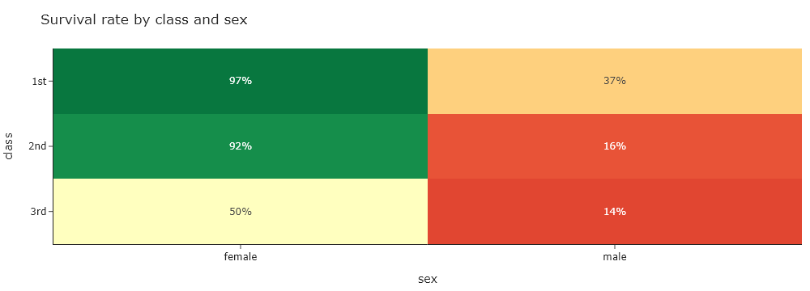
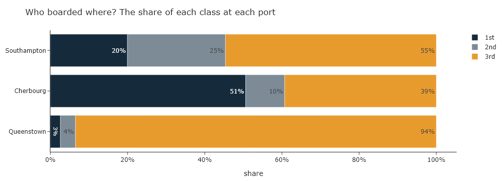

# Who survived the Titanic?

An exploratory analysis of 891 Titanic passengers (sex, class, age, family, port and fare against survival),
and an interactive dashboard built on the cleaned data.



## The questions
How many survived? Did sex and class decide, and which mattered more? Were children saved first? Did family
help? Why did Cherbourg passengers survive more often? Did the fare matter beyond the class?

## Key findings
- **342 of 891 passengers survived (38%).**
- **Sex was the strongest factor:** 74% of women survived, 19% of men.
- **Class set the level:** 97% of first-class women survived, half of third-class women, 14% of third-class men.
- **Children:** about 58% survived; all 12 boys in first and second class, 39% of the boys in third.
- **The port effect is mostly a class effect:** half of the Cherbourg passengers travelled first class.



## The dashboard
A Streamlit app with filters for class, sex, port and age: KPIs (passengers, survivors, survival rate, median
fare) and four tabs.

| Tab | What it shows |
|---|---|
| Who survived? | the survival rate and the passenger count by sex, class, age group, title, family size or port |
| Two groups | the survival rate for every combination of two columns; the class mix of each port |
| Ages and fares | ages of survivors and victims; fares by class and outcome |
| Passengers | the filtered passengers, downloadable as CSV |

## Data
The *Titanic* training file ([Kaggle](https://www.kaggle.com/competitions/titanic/data)): 891 passengers, one row
each, with class, name, sex, age, family on board, ticket, fare, cabin and port.

**Cleaning decisions** (details in the notebook):
- `Cabin` (77% missing, mostly a proxy for class) and `Ticket` dropped
- 2 missing ports filled with Southampton, the most common
- 177 missing ages filled with the median age of the passenger's title (Mr, Mrs, Miss, Master, Rare),
  flagged in `age_known`
- fares of £0 and £512 kept: real values

## Limitations
891 of about 1,300 passengers and no crew; estimated ages; small groups; no information on where people were
when the ship hit the iceberg.

## Files
```
├── analysis.ipynb      the analysis: questions, cleaning, exploration, answers
├── streamlit_app.py    the dashboard: data, filters, KPIs, tabs
├── charts.py           one function per chart (Plotly), shared by the notebook and the app
└── images/             figures used in this README
```
The data is in the repository's [`data/`](../../data/): `titanic.csv` (raw) and `titanic_clean.csv` (written by
the notebook, read by the app).

## Run it
From the repository folder, after `uv sync`:
```bash
uv run streamlit run 6-projects/01-titanic/streamlit_app.py
```

## Built with
Python 3.13 · pandas · Plotly · Streamlit
