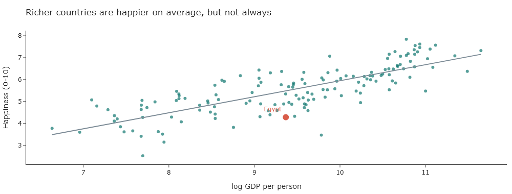
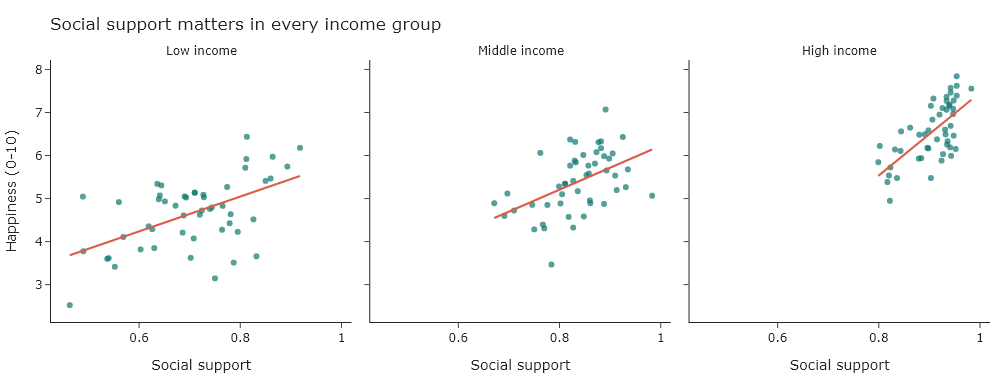

# What goes with a happy country? World Happiness 2021

An exploratory analysis of the World Happiness Report 2021 (149 countries), with a closer look at Egypt, and
an interactive dashboard built on the cleaned data.



## The questions
How is happiness spread? Which regions are the happiest? Which factors move with happiness? Is it only money?
Does social support matter between countries of the same income? Where is Egypt, and what pulls it down?

## Key findings
- **Happiness is symmetric around 5.5** (0–10 scale), from Afghanistan (2.52) to Finland (7.84).
- **Money, health and social support** move most with happiness (r = 0.79, 0.77, 0.76), and they move with
  each other: correlation, not causation.
- **Money is not everything:** countries with the same GDP can be 2 points apart.
- **Social support matters within every income group** (r = 0.48–0.67).
- **Egypt ranks 132nd of 149**, although it is in the middle income group (86th in GDP): it ranks lower in
  social support, health, freedom and generosity, and scores 0.78 below what its factors predict.



## The dashboard
A Streamlit app with filters for region, income group, happiness range and a focus country (Egypt by default):

| Tab | What it shows |
|---|---|
| Overview | KPIs (countries, average happiness, happiest country, focus country's rank); a world map coloured by happiness or any factor; the distribution |
| Groups | average happiness and its spread by region or income group |
| Factors | any factor against happiness with its correlation; the correlation of every factor |
| Compare | the focus country against chosen countries on any column; a table to download |

## Data
*World Happiness Report 2021* ([Kaggle](https://www.kaggle.com/datasets/ajaypalsinghlo/world-happiness-report-2021),
from the report's data, based on the Gallup World Poll, 2018–2020). One row per country: the ladder score, its
confidence interval, six factors, and the report's split of the score into parts.

**Cleaning decisions** (details in the notebook):
- uncertainty and Dystopia columns dropped; the report's split kept apart for the Egypt analysis
- validation rules checked (ranges, one row per country); no missing values or duplicates
- negative generosity and all IQR outliers kept: real values, not errors
- added the rank, GDP in dollars and three income groups of equal size

## Limitations
One edition (2018–2020 averages); countries, not people; correlation only; survey answers depend on culture.

## Files
```
├── analysis.ipynb      the analysis: questions, cleaning, exploration, answers
├── streamlit_app.py    the dashboard: data, filters, tabs
├── charts.py           one function per chart (Plotly), shared by the notebook and the app
└── images/             figures used in this README
```
The data is in the repository's [`data/`](../../data/): `world_happiness_2021.csv` (raw) and
`world_happiness_clean.csv` (written by the notebook, read by the app).

## Run it
From the repository folder, after `uv sync`:
```bash
uv run streamlit run 6-projects/02-world-happiness/streamlit_app.py
```

## Built with
Python 3.13 · pandas · Plotly · Streamlit
