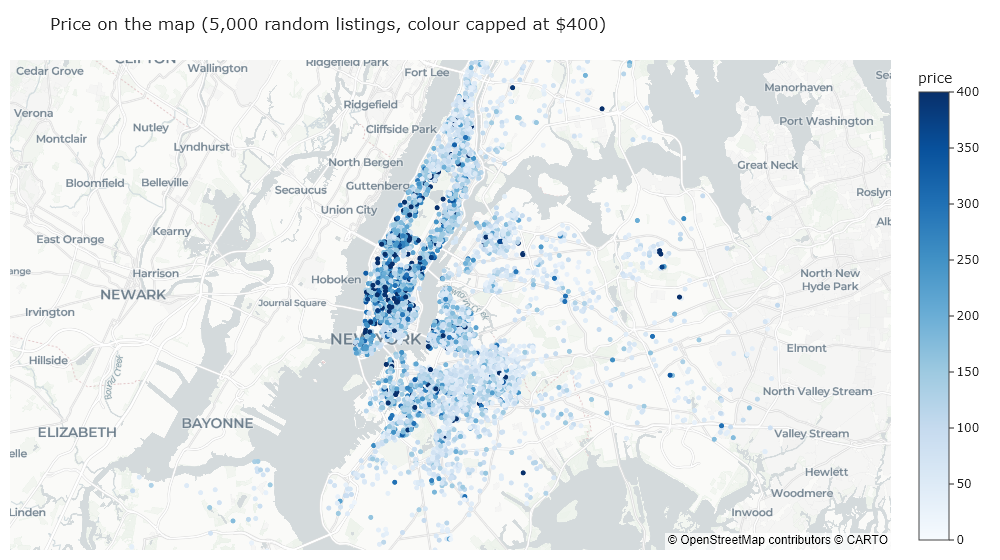
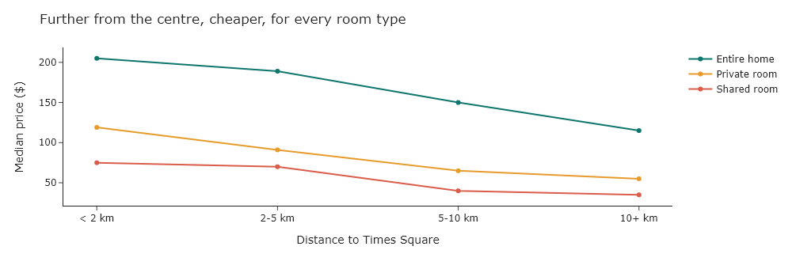
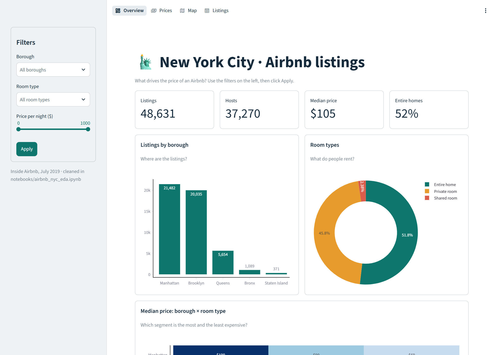

# NYC Airbnb: what sets the price of a night?

An exploratory analysis of the 48,895 Airbnb listings in New York City (2019), and an interactive dashboard
built on the cleaned data.



## The question
What drives the asking price of an Airbnb night in New York: the borough, the room type, the distance to the
centre, the reviews? And for a family that wants an entire home near the centre, where is the best value?

## Key findings
- **A typical night costs $105** (median); half of the listings cost $69–175. Prices are strongly right-skewed,
  so groups are compared by their median.
- **The room type sets the level:** entire home $160, private room $70, shared room $45, in the same order in
  every borough.
- **Location means distance, not the borough's name:** the median drops from $181 under 2 km of Times Square to
  $75 beyond 10 km, for every room type. An entire home in Brooklyn 2–5 km away ($175) costs more than one in
  Manhattan 5–10 km away ($160).
- **Best value for a family:** an entire home in Queens 2–5 km from Times Square, $149 a night, about $40 less
  than Manhattan at the same distance.
- **Reviews don't set the price** (Spearman r = -0.05). **Most hosts are individuals** (86% have one listing),
  but under 1% of the hosts own about 10% of the listings.



## The dashboard
A four-page Streamlit app on the cleaned data, with filters for borough, room type and price:



| Page | What it shows |
|---|---|
| Overview | listings, hosts, median price, share of entire homes; listings by borough; room types; borough × room type prices |
| Prices | price distribution; median price by room type, borough, distance or host type; the most expensive neighbourhoods |
| Map | up to 5,000 listings on a map, coloured by price |
| Listings | search the listing names, browse the results, download them as CSV |

## Data
*New York City Airbnb Open Data* (Kaggle), from [Inside Airbnb](http://insideairbnb.com) (CC BY 4.0), 2019.
One row per listing: location, room type, price, minimum stay, reviews, host and availability.

**Cleaning decisions** (details in the notebook):
- removed listings priced at $0 or above $1,000 (placeholders) and minimum stays above a year: 264 rows (0.5%)
- missing `reviews_per_month` filled with 0: they are exactly the listings without reviews
- kept the statistical (IQR) outliers: an expensive Manhattan flat is not an error
- dropped `host_name` (personal data); added the distance to Times Square (haversine), distance bands and host types

## Limitations
Asking prices, not paid prices; a 2019 snapshot; 36% of the listings can't be booked; no size or rating data.

## Files
```
├── analysis.ipynb      the analysis: questions, cleaning, exploration, answers
├── streamlit_app.py    the dashboard: data, filters, navigation
├── views/              the four pages
├── charts.py           one function per chart (Plotly), shared by the notebook and the app
├── images/             figures used in this README
└── .streamlit/         the theme
```
The data is in the repository's [`data/airbnb/`](../../data/airbnb/): `AB_NYC_2019.csv` (raw) and
`airbnb_cleaned.csv` (written by the notebook, read by the app).

## Run it
From the repository folder, after `uv sync`:
```bash
uv run streamlit run 6-projects/03-airbnb-nyc/streamlit_app.py
```
The notebook uses the same Plotly charts as the dashboard (it imports `charts.py`).

## Built with
Python 3.13 · pandas · Plotly · Streamlit
